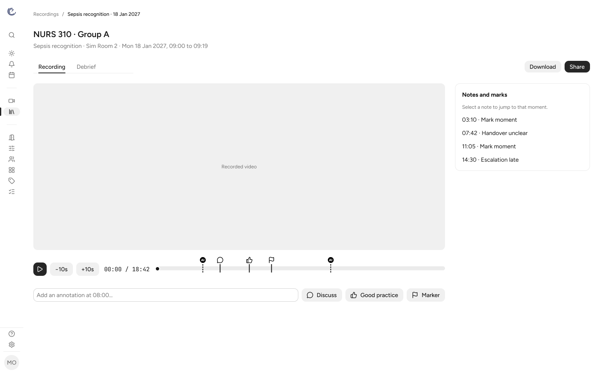
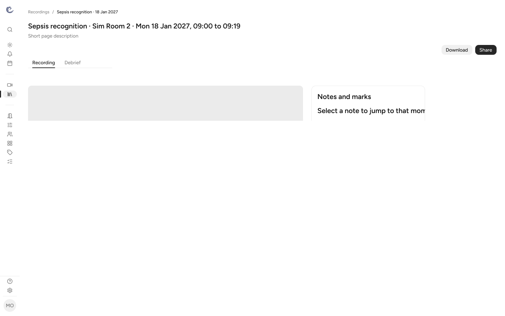
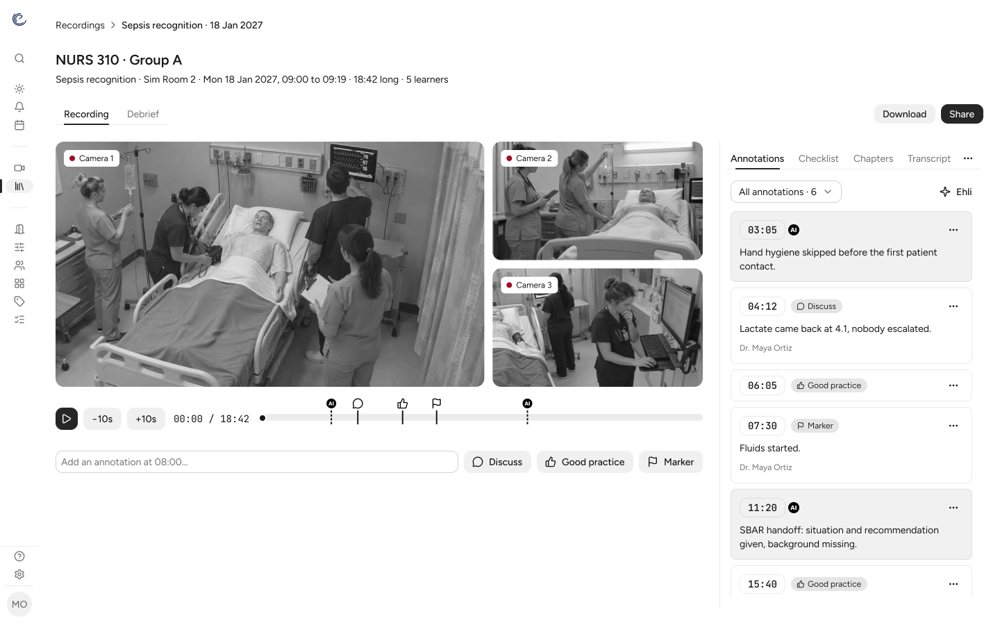
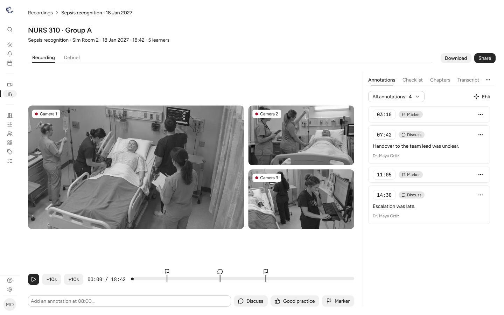
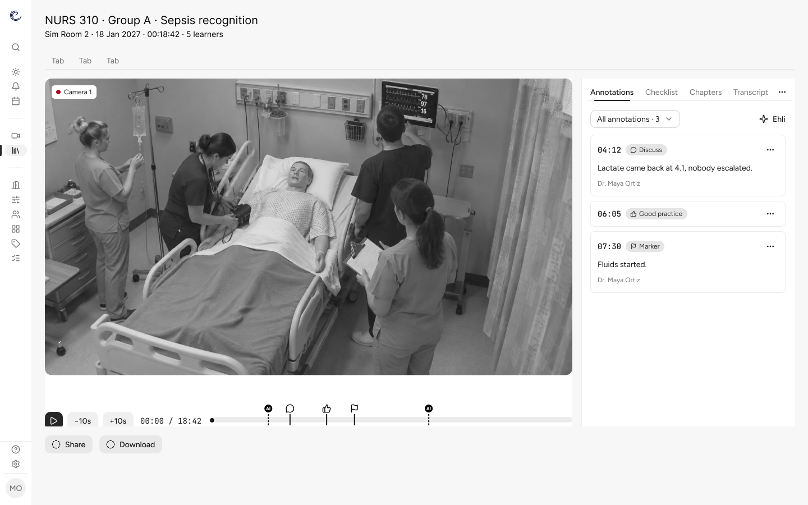
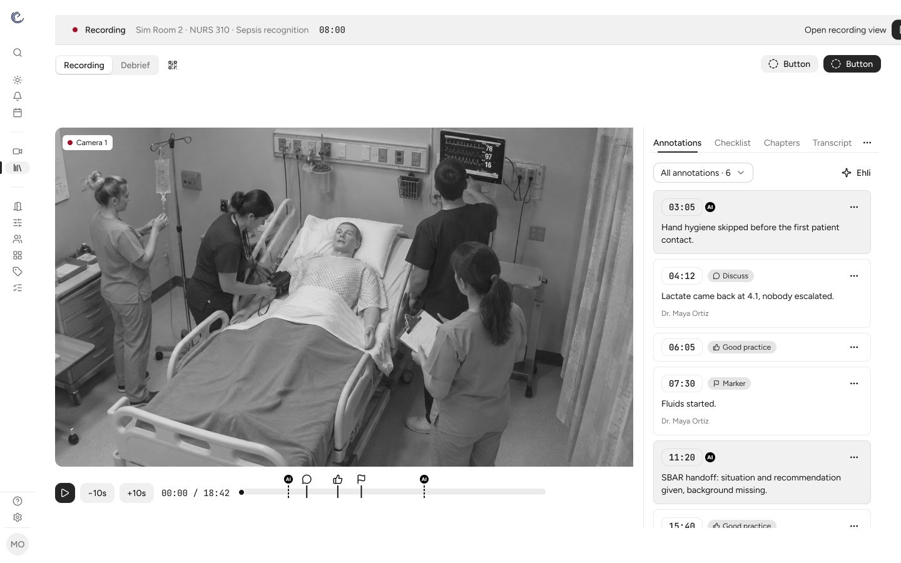

# Which Cursor setting to use for Figma work

Daniel Brassnyo · tested 22 Nov 2026, usage data from Cursor's team export (25 Nov)

## The short version

Use **Auto · Intelligence** for design work in Figma. In our test it was as good as picking Sonnet 5.5 High by hand, it was a bit faster, and it cost about a third less per build.

Don't use **Auto · Cost** for this. It is very cheap, but it left placeholder text and broken layouts, and its own report said everything had passed.

| Setting | Model it actually ran | Quality | Avg. cost per build | Avg. time |
|---|---|---|---|---|
| Auto · Intelligence | Sonnet 5.5 High | Good, every time | $2.51 | 7m 12s |
| Auto · Balance | Sonnet 5.5 High | Good, every time | $2.83 | 7m 41s |
| Sonnet 5.5 High (picked by hand) | Sonnet 5.5 High | Good, every time | $3.87 | 9m 12s |
| Auto · Cost | not named in the log ("auto"); the run itself said Composer | Not usable | $0.41 | 3m 05s |

## What we did

After the expensive models were switched off on 18 Nov, I wanted to know which setting to use for design work. I gave Cursor the same job each time: build three greyscale wireframes in our Figma file (the Recordings list, a Recording page and its Debrief tab), using our component library.

I ran it in three rounds:

1. **A very detailed prompt** with node ids, build steps and checklists. This tests how well a setting follows a precise spec.
2. **A short brief** (what each screen is for, the sketches, "reuse the library"). This tests the model's own judgement.
3. **The same short brief with copying banned**, so every run had to build the screens from components. I ran every setting twice here to see whether it gives the same result again.

Every run started in a fresh chat with no follow-up fixes. Claude reviewed each result from screenshots against the same checklist (8 items, 0–2 points each). Round 1 is scored out of 14 because one item could not be checked; rounds 2 and 3 are out of 16.

## What it looked like

All examples show the same screen, the Recording page, so you can compare them directly.

### Round 1, detailed prompt

**Auto · Intelligence, 13 / 14.** Everything is there: the title, tabs, video, timeline with markers, notes and the annotation field. Sonnet 5.5 High and Balance built practically the same screen.

**Auto · Cost, 7 / 14.** The page stops just below the tabs, so the video, the timeline and the notes are cut off. The title shows the date line instead of the course name, and the placeholder "Short page description" is still there. Its report said every check had passed.

### Round 3, short brief with copying banned

**Auto · Intelligence, 15 / 16.** Built entirely from library components: three camera views, timeline, annotation panel, breadcrumb, Download and Share. Sonnet 5.5 High built almost exactly the same screen.

**Auto · Balance, 16 / 16, the best run.** The same build, but it also replaced the component's sample notes with the four notes and times from our sketch.

**Auto · Cost, first run, 11 / 16.** The tabs read "Tab Tab Tab", there is no breadcrumb and no annotation field, and Share and Download sit under the video with placeholder icons.

**Auto · Cost, repeat, 7 / 16.** The buttons read "Button", there is no page title, and it used the live-recording banner ("Recording · 08:00 · Open recording view") on a session that has already finished.

## Results, run by run

Costs and models come from Cursor's usage log. Times come from the Cursor chats.

| Round | Setting | Time | Score | Cost |
|---|---|---|---|---|
| 1 · detailed | Sonnet 5.5 High (by hand) | 5m 55s | 13 / 14 | $2.65 |
| | Auto · Intelligence | 5m 18s | 13 / 14 | $1.82 |
| | Auto · Balance | 5m 40s | 13 / 14 | $2.09 |
| | Auto · Cost | 3m 43s | 7 / 14 | $0.63 |
| 2 · short brief | Sonnet 5.5 High (by hand) | 12m 24s | 15 / 16 | $4.95 |
| | Auto · Intelligence | 7m 10s | 15 / 16 | $2.27 |
| | Auto · Balance | 2m 11s | 14 / 16 (copied the existing screens) | $0.93 |
| | Auto · Cost | 1m 04s | 12 / 16 (copied the existing screens, changed nothing) | $0.20 |
| 3 · no copying | Sonnet 5.5 High (by hand) | 9m 08s / 9m 21s | 15 / 15 | $3.64 / $4.23 |
| | Auto · Intelligence | 7m 17s / 9m 04s | 15 / 15 | $2.46 / $3.49 |
| | Auto · Balance | 9m 24s / 13m 30s | 16 / 15 | $3.36 / $4.94 |
| | Auto · Cost | 4m 43s / 2m 51s | 11 / 7 | $0.54 / $0.27 |

In round 3 the second Balance run was blocked by a Figma rate limit (more on that below) and I reran it on its own. The blocked attempt still cost $0.63. The whole test, 17 runs, cost **$39.10**.

## What stood out

**Balance and Intelligence run the same model.** The usage log shows both used Sonnet 5.5 High in every run, the same model as picking it by hand. So the differences between these three are not about the model, but about how much work each run did. I checked our other Cursor work from 24 Nov too: Auto picked Sonnet 5.5 High there as well (seven requests).

**Intelligence used fewer tokens than picking Sonnet High by hand.** Same model, same quality, but it was cheaper in every round: $1.82 vs $2.65, $2.27 vs $4.95, and $2.46 / $3.49 vs $3.64 / $4.23. It was also faster each time. Over a day of design work, that adds up.

**Auto · Cost looks cheap but isn't.** At about $0.40 per build it costs a sixth to a tenth of the others. But in round 1 two of the three screens were cut off below the tabs, the titles were wrong and placeholder text was left in, and its report still said every check had passed. In round 3 it left "Tab Tab Tab" and "Button" labels, put a live-recording banner on a past recording, and scored 11 and then 7. Fixing that by hand costs more than the $2–3 you save per build.

**Copying is a shortcut.** When the brief allowed it (round 2), Balance and Cost copied our finished screens instead of building. Balance at least checked the copies against the sketches and fixed what was off; Cost changed nothing. That's why their round 2 times and costs are so low. Once copying was banned, Balance gave the best single run of the whole test (16 / 16).

**Repeat runs were consistent, except for Cost.** Sonnet High, Intelligence and Balance scored the same or within one point on the repeat, with mostly the same layout (the Intelligence and Balance repeats showed one camera view instead of three). Cost went from 11 to 7 and built the screens differently each time.

**Running chats in parallel.** Four runs at once (rounds 1 and 2) worked fine. Eight at once (round 3) hit the Figma tool's rate limit for my seat: one run was blocked completely and others slowed down. So keep it to about four at a time.

## What this means for us

- **Default for Figma and design work: Auto · Intelligence.** Same quality as Sonnet 5.5 High by hand, about a third cheaper and a bit faster in this test.
- **Auto · Balance is fine too.** It ran the same model and scored the same. In this test it cost a little more than Intelligence, but the gap is small.
- **Don't use Auto · Cost for design builds.** Its output breaks and its report doesn't say so.
- **Keep checking the result in Figma.** In round 1, Cursor's own report said the broken Cost run had passed every check; only looking at the screens caught it.

## Limits worth knowing

- It's a small test: one task (three screens), one or two runs per setting per round. The cost and speed gaps were consistent, but they come from 4 builds per setting.
- Claude scored from screenshots, not by checking every layer. In round 3 it checked the Recording page for the Sonnet-based runs and all three screens for the Cost runs.
- The usage log doesn't say which run was which. I matched them by start time, setting and size; within round 3 I assumed I started the first runs before the repeats, which fits the run lengths.
- We don't know whether Auto keeps choosing Sonnet 5.5 High for other kinds of work or on other days.

Every run is on the Figma page "🧪 Cursor model test · 11-22" in IMSH-MVP, one section each, if you want to see the other screens.
